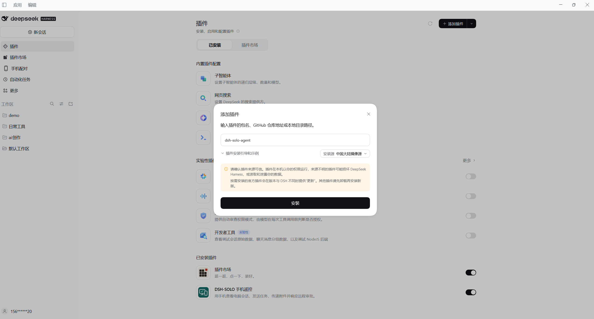
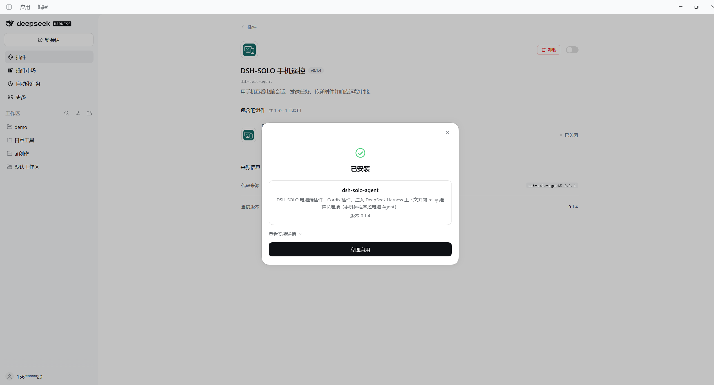
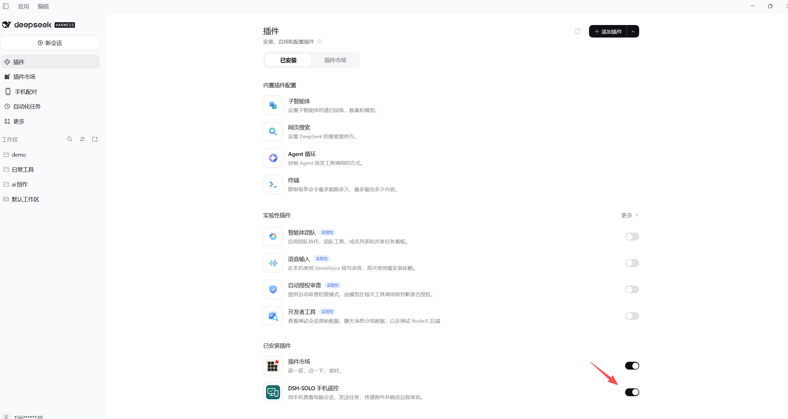
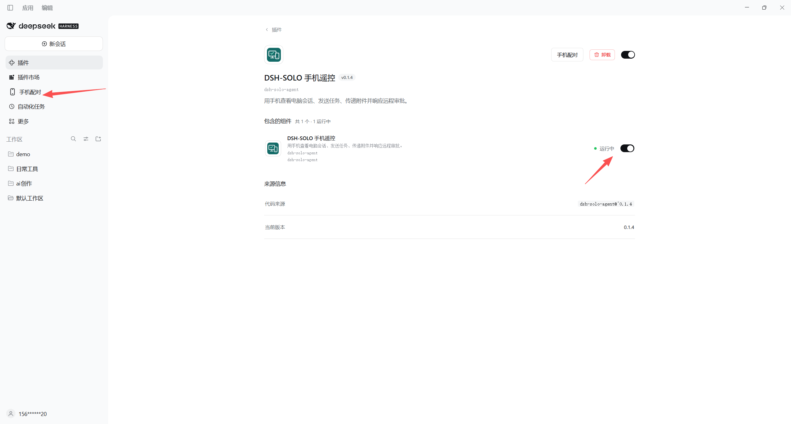
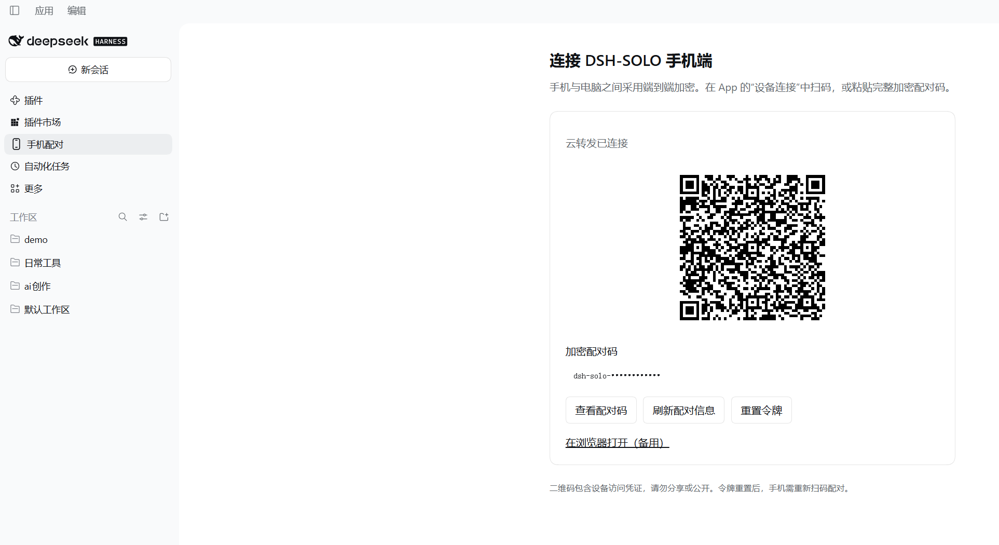
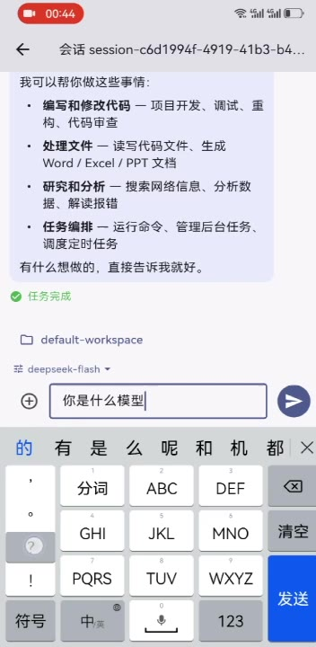
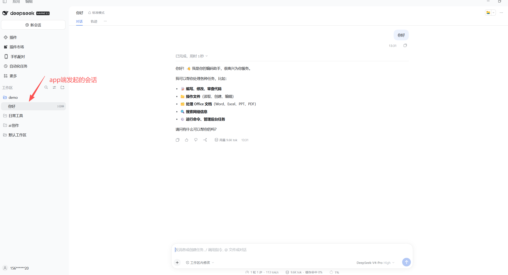
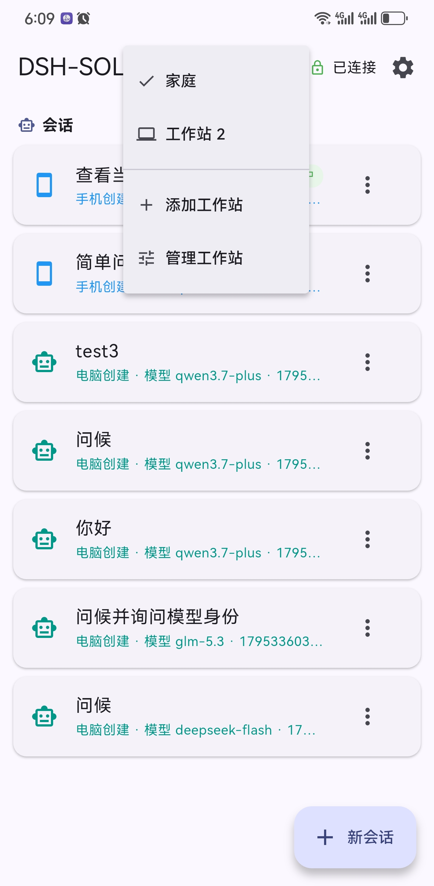
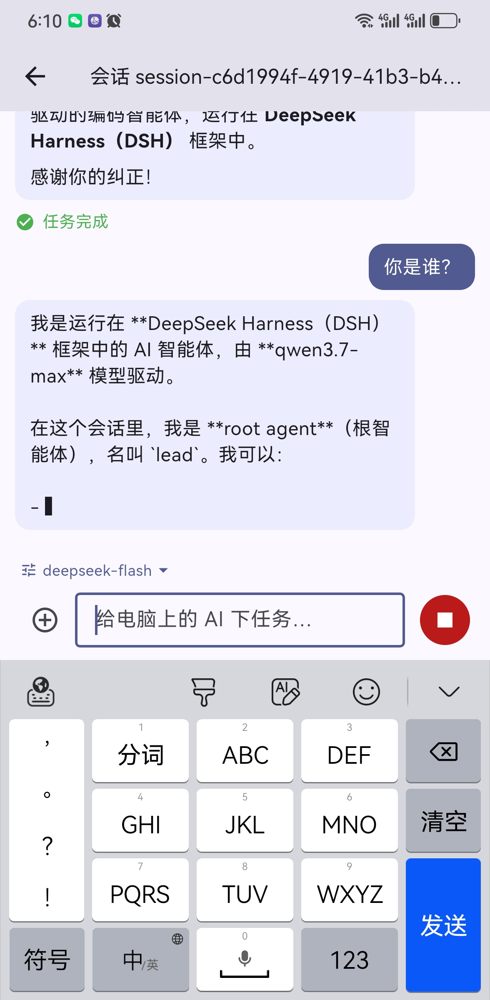
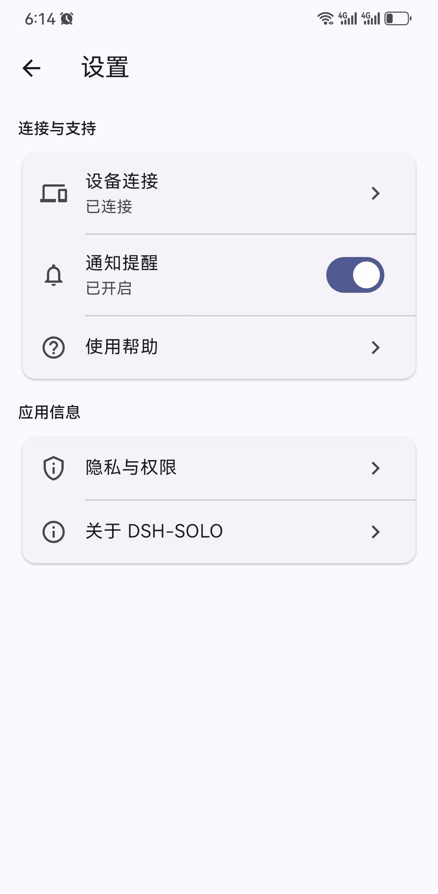

# DSH-SOLO

[](https://www.npmjs.com/package/dsh-solo-agent) [](https://github.com/wudidiandian/dsh-solo/releases) [](LICENSE)

> **正式版 0.1.9** 已发布，支持会话内真正切换模型（与桌面端同一路径，含自定义模型），模型显示与电脑端一致；包含 0.1.8 的跨 provider 模型目录聚合，以及 0.1.7 的设备管理与单设备撤销、多工作站管理、后台系统通知、手机中断电脑端任务、会话名称同步与二维码自动刷新。[查看发布包](https://github.com/wudidiandian/dsh-solo/releases/tag/v0.1.9) · [下载 Android APK](https://github.com/wudidiandian/dsh-solo/releases/latest/download/dsh-solo.apk)。建议将电脑插件和手机 App 一起更新。

> **升级提示（0.1.7 – 0.1.9）**：设备管理、多工作站、后台通知、手机中断任务等新功能需**同时安装 0.1.7 及以上电脑插件与手机 App** 才能使用；只更新一端时基础功能不受影响，但新功能不可用。升级保留配对数据，通常无需重新扫码；若该手机曾在电脑配对页被撤销，则需重新扫码配对。中转服务端本版本无协议改动，自建用户无需重新部署。

| 组件 | 支持 E2EE 的最低版本 | 升级 0.1.9 是否必须更新 |
| --- | --- | --- |
| 电脑插件 `dsh-solo-agent` | 0.1.5 | 是（新功能依赖插件） |
| 手机 App | 0.1.5 | 是（新功能依赖 App） |
| 中转 relay（含自建） | 0.1.5 | 否（0.1.5 之后无协议改动） |

0.1.4 及更早客户端与 E2EE 三端不兼容；跨 0.1.5 升级需三端配套并重新扫码。

**中文** | [English](README_EN.md)

通过手机远程使用电脑上的 DeepSeek Harness：查看会话、发送任务、切换模型、传递附件，并审批需要确认的操作。

**目录**：[安装与使用](#安装与使用) · [多工作站](#5-管理多台电脑多工作站) · [设备管理](#6-设备管理与单设备撤销) · [通知与停止](#7-后台通知与停止任务) · [功能](#功能) · [常见问题](#常见问题) · [安全与隐私](#当前安全与隐私) · [自建与源码构建](#自建与源码构建) · [路线图](#功能路线图)

> **手机 App 与电脑插件之间支持端到端加密。** 从 `0.1.4` 升级时，中转、插件与 App 需要配套更新，并扫描新版二维码重新配对。自建用户请先阅读 [升级与回滚说明](deploy/E2EE_UPGRADE.md)。

## 安装与使用

**DSH-SOLO 官方插件已内置官方云转发服务配置。普通用户只需要安装电脑端插件和手机 App，无需部署服务端，也无需填写服务器域名。** 扫码即可将手机与自己的电脑配对。

### 1. 安装电脑端插件（推荐）

在 **DeepSeek Harness 官方桌面版** 中，进入 **插件 → 添加插件**，输入以下包名并点击 **安装**：

```text
dsh-solo-agent
```

安装后点击 **立即启用**。如果左侧没有出现 **手机配对**，通过 **应用 → 退出** 完全退出桌面版，再重新打开；只关闭窗口可能隐藏到托盘。

省略版本号时安装 npm `latest` 标签对应的正式版；需要指定版本时可输入 `dsh-solo-agent@0.1.9`。如果提示找不到插件，请先将安装源切换到 **官方 npm 源**，国内镜像可能尚未同步。已安装的插件需要按宿主提示更新，或卸载后重新安装；通常可保留用户主目录 `.dsh-solo` 中的配对数据。

<details>
<summary>查看插件安装图解（点击展开）</summary>

**① 添加插件，输入 `dsh-solo-agent`**



**② 安装成功后，点击「立即启用」**



**③ 确认插件开关已打开**



**④ 组件显示「运行中」，打开左侧「手机配对」**



</details>

### 2. 下载手机 App

- **[下载最新版 Android APK](https://github.com/wudidiandian/dsh-solo/releases/latest/download/dsh-solo.apk)**
- [查看全部 Releases、版本说明与插件安装包](https://github.com/wudidiandian/dsh-solo/releases)

下载 `dsh-solo.apk` 后在 Android 手机上安装；插件与 App 的版本兼容性以发布说明为准。安装包发布在本项目仓库的 Releases，可直接下载。

**iPhone 用户**：iOS 版本正在 TestFlight 外部测试中，可[加入 iOS 测试](https://testflight.apple.com/join/fjtvUWkU)。请先从 App Store 安装免费的 TestFlight，再打开邀请链接安装测试版；测试版尚未正式上架，欢迎通过项目 Issues 反馈问题。

### 3. 扫码配对

1. 在 DeepSeek Harness 官方桌面版左侧点击 **手机配对**；插件详情页也有此入口。
2. 在手机 App 中点击 **扫码配对**，扫描页面内的二维码，确认后连接。地址与令牌自动填入。
3. 不方便扫码时，在电脑配对页点击 **查看配对码**，再将完整加密配对码粘贴到 App；官方 App 已预置官方云转发地址。

使用时电脑上的 DeepSeek Harness 和插件需要保持运行，电脑与手机均需联网。二维码包含设备配对凭证，请勿公开分享。Android 有正式安装包，iOS 目前通过 TestFlight 提供测试版。

<details>
<summary>查看电脑端手机配对页面（点击展开）</summary>



图中的二维码仅用于演示。请扫描自己电脑插件中的二维码；令牌重置后，旧二维码失效。面板下方列出已配对手机，可单设备撤销；二维码随密钥轮换自动刷新。

</details>

### 4. 使用演示

[▶ 观看 App 完整操作视频（约 4 分 13 秒）](docs/videos/app-usage.mp4)

点击下方预览图打开视频，演示扫码配对、选择电脑项目、发送任务与流式回复、停止任务、审批卡片、后台系统通知、多工作站切换与电脑端设备撤销。

<a href="docs/videos/app-usage.mp4"></a>

**手机创建的会话会同步到电脑端所选项目：**



发送第一条任务前，点击 **＋ → 选择项目**，选择电脑端已添加的项目，新会话会创建在该项目下；已有会话保持原位置。项目列表只获取名称和标识，不扫描项目文件。

主页右上角齿轮提供 **设备连接、使用帮助、隐私与权限、关于 DSH-SOLO**；可查看版本、开源许可和项目链接，或复制不含令牌及聊天内容的连接诊断。

### 5. 管理多台电脑（多工作站）

- 主页右上角**电脑图标**打开工作站菜单：列出已配对电脑，点击即切换；会话、模型与目录随工作站隔离。
- **添加工作站**：菜单内点击后扫描另一台电脑的配对二维码（或粘贴配对码），保存即入库。
- **管理工作站**：重命名或删除配对；删除后该电脑需重新扫码才能再连。
- 重复扫描**同一台电脑**不会新增条目：自动更新既有配对并切换过去。



### 6. 设备管理与单设备撤销

- 电脑端**手机配对**面板（或备用浏览器页）列出已配对手机：名称、最近在线时间。
- 点击**撤销**：该手机立即断开且无法重连，需扫描当前二维码重新配对；它在这台电脑上的所有工作站配对一并失效。
- **重置令牌**会清空全部设备并更换主密钥：所有手机都需重新扫码。
- 旧版 App 不注册设备身份，不会出现在列表中，也无法单独撤销；建议升级到 0.1.7。
- 二维码随密钥轮换**自动刷新**（面板与浏览器页均轮询），请始终扫当前显示的码。

### 7. 后台通知与停止任务

- 首次连上电脑时 App 会询问是否开启通知：选择**开启通知**后授予系统权限；**暂不**则不再打扰，之后可在**设置 → 通知提醒**开启（系统已拒绝时跳转系统设置页）。
- App 退到后台时，任务完成、待审批、任务停止会弹系统通知，点击直达对应会话；进程被系统杀死后不推送（离线推送在路线图中）。
- 会话运行中时输入框右侧发送按钮变为红色**停止**：点击即中断电脑端当前回合，会话内显示"任务已停止"。
- 电脑端创建或改名的会话，名称自动同步到 App 会话列表。

 

### 其他方式：使用插件安装包

需要离线安装或固定归档时，从 [Releases](https://github.com/wudidiandian/dsh-solo/releases) 下载 `dsh-solo-agent-<版本号>.tgz`。

1. 将 `.tgz` 解压到准备长期保留的目录。有些工具需先解出 `.tar`，再解出文件夹。
2. 找到包含 `package.json` 的 **`package` 文件夹**，例如 `D:/DSH-SOLO/plugin/package`。
3. 在 DeepSeek Harness 官方桌面版 **插件 → 添加插件** 中输入该文件夹的绝对路径，安装并启用。

不要填写单个 `.js` 文件或未解压的 `.tgz`。本地安装会链接到该文件夹，安装后请保留原位置。已有同名插件时先卸载，再安装并按提示重启。

第三方 `dsh-market` 插件市场还需单独收录；发布 npm 或公开 GitHub 不会自动完成市场收录。

## 功能

- 查看会话和实时回复，重连后同步事件；电脑端创建或改名的会话同步保留名称。
- 创建任务、选择模型、重命名和删除会话；运行中可在手机上中断电脑端当前任务。
- 在手机上允许或拒绝远程审批、回复模型提问。
- 上传图片与文件、选择电脑端项目创建会话、发送文档链接。
- 查看 Markdown 回复与代码差异。
- 多工作站：一台手机配对多台电脑，随时切换；重复扫同一台电脑自动更新既有配对。
- 设备管理：电脑端配对页列出已配对手机，可单设备撤销；撤销后该设备需重新扫码。
- 后台系统通知：任务完成、待审批、任务停止时提醒，点击直达会话（App 进程存活期间）。

## 常见问题

**安装时找不到插件或版本很旧？** 国内 npm 镜像同步有延迟：把安装源切换到官方 npm 源，或指定 `dsh-solo-agent@0.1.9`。第三方 dsh-market 的版本号每日自动刷新，简介改动才需要收录 PR。

**桌面左侧没有"手机配对"？** 只关窗口可能隐藏到托盘：通过 应用 → 退出 完全退出桌面版再重开，并确认插件开关已启用。

**扫码提示"加密配对验证失败"？** 扫到了失效的旧二维码：主密钥会在新设备注册/重置时轮换，配对页二维码自动刷新，请扫当前显示的码；被撤销的手机必须重新扫码；重置令牌后所有手机重新配对。

**显示"已连接"但会话列表为空或工具不可用？** 连上中转不等于连上电脑：确认电脑未休眠、桌面版与插件在运行；状态徽标区分"中转已连接 / 电脑在线 / 鉴权失败"。

**后台收不到通知？** 检查系统通知权限：设置 → 通知提醒 → 开启（被永久拒绝时跳转系统设置）。Android 12 及以下默认允许；App 进程被杀死后不推送属当前限制。

**APK 为什么有 70 多 MB？** 正式包内置 arm64 / arm32 / x86_64 三种架构的 native 库，安装时只释放本机架构；测试预览包仅 arm64 约 26MB。

**升级后要重新配对吗？** 0.1.6 → 0.1.9 通常不用（配对数据保留），被撤销的手机除外；0.1.4 → 0.1.5+ 必须三端配套升级并重新扫码（E2EE 不兼容旧客户端）。

## 当前安全与隐私

```
┌────────────┐  WSS·密文  ┌─────────────┐  WSS·密文  ┌──────────────────┐
│  手机 App  │ ────────▶ │  中转 relay  │ ────────▶ │ 电脑插件(DSH 内) │
│  Flutter   │ ◀──────── │  Go·可自建   │ ◀──────── │  Cordis 插件     │
└────────────┘           └─────────────┘           └──────────────────┘
       ▲                                                   ▲
       └───────── 端到端加密 X25519 + AES-256-GCM ──────────┘
                  密钥只存在于两端；中继仅见密文与流量元数据
```

从 0.1.5 起，手机 App 与电脑插件之间使用**端到端加密**：扫码提供独立于连接令牌的加密凭据，经认证的临时 X25519 密钥交换建立每台手机各自的会话，业务内容使用 AES-256-GCM 加密并校验完整性与消息顺序。消息、工具结果、项目列表、审批和附件正文都在端侧加解密。0.1.7 起每台手机注册后领取**设备专属密钥**，主配对密钥随之轮换：电脑端可单独撤销某台手机，被撤销设备持有的旧二维码与旧设备密钥均失效；配对页二维码随轮换自动刷新。

中转只转发密文，不持有加密凭据或解密密钥；连接 IP、连接令牌、时间与流量大小仍可见。重连历史从电脑端重新加密获取，公网仍应使用 WSS。App 的配对凭据使用系统安全存储；本机会话缓存尚未增加应用层静态加密。

旧二维码与单独连接令牌不能完成新版本配对。请保管完整二维码和加密配对码；重置后所有手机均需重新配对。电脑端及其配置的模型服务仍会处理任务内容。已完成功能与实机验证，尚未经过独立安全审计，详见 [加密设计与测试说明](docs/E2EE.md)。

## 自建与源码构建

源码构建默认连接本机，不包含官方服务器地址。手机自建使用时，请通过电脑端配对二维码获取手机可访问的地址。

环境：Node.js 22、Go 1.22 或更高版本；App 使用 Flutter 3.47.7 / Dart 3.13.5，Android 使用 JDK 17。构建工具版本以工程文件为准。

```sh
npm ci
npm run configure
npm run build
npm run bundle --workspace=dsh-solo-agent
npm test
npm run test:go
```

- [统一配置与发布说明](docs/RELEASING.md)：三端配置、签名、GitHub 自动构建。
- [桌面版插件安装与市场分发](docs/PLUGIN_INSTALLATION.md)：标准安装包、本地验证和第三方市场收录。
- [自建部署](deploy/SELF_HOST.md)：Docker、局域网和隧道接入。
- [服务端监控与部署接管](deploy/MONITORING.md)：维护者登录、连接统计、资源趋势和升级验收。
- [协议定义](packages/protocol/src/index.ts)：开发与集成参考。
- [贡献指南](CONTRIBUTING.md)。

本机运行中转服务：`npm run relay`。插件的 `relayUrl` 可以覆盖构建默认值；手机扫码获取地址和令牌，两端使用相同令牌配对。

## 功能路线图

已完成和计划中的功能如下；优先级会根据使用反馈和开发进展调整，具体可用功能以 Release 说明为准。

- [x] **端到端加密**：手机与电脑插件之间的消息、工具、项目、审批和附件加密，包含系统安全存储与防重放。
- [x] **加密密钥管理增强**：设备专属密钥、配对页设备列表与单设备撤销、密钥轮换与二维码自动刷新。
- [x] **多工作站管理**：一台手机配对多台电脑并切换；同机重复扫码自动更新既有配对。
- [x] **系统通知**：App 后台时任务完成/待审批/任务停止的系统通知提醒，点击直达会话。
- [ ] **离线推送**：App 进程被系统杀死后的推送，需 FCM 或厂商推送通道，尚未实现。
- [x] **手机中断任务**：运行中会话可在手机上停止电脑端当前回合。
- [ ] **iOS App**：TestFlight 外部测试中，持续完善并准备正式发布。
- [ ] **鸿蒙端 App**：完成鸿蒙平台适配、HAP 构建与真机验证。
- [ ] **语音输入任务**：将语音转为任务文本，方便在手机上发送指令。

欢迎通过 [Issues](https://github.com/wudidiandian/dsh-solo/issues) 反馈需求和使用场景。

## 项目结构

| 目录 | 内容 |
| --- | --- |
| `packages/agent` | 电脑端 Cordis 插件 |
| `packages/protocol` | 通信协议 |
| `app` | Flutter 移动端 |
| `server` | Go 中转服务 |
| `deploy` | 自建部署配置 |

通信方式：手机 App ↔ WebSocket 中转服务 ↔ 电脑端插件。公网部署请使用 WSS。

## 许可证

[MIT](LICENSE)
