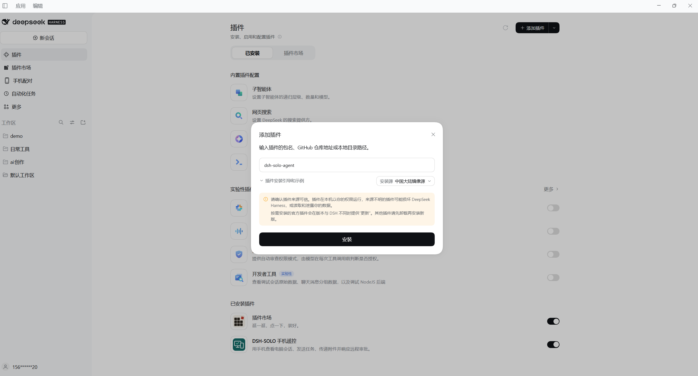
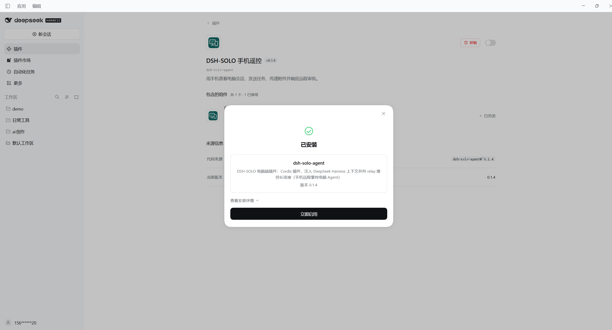
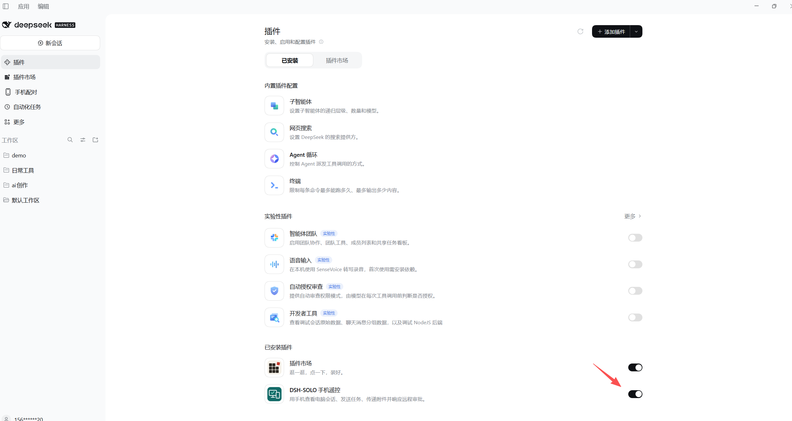
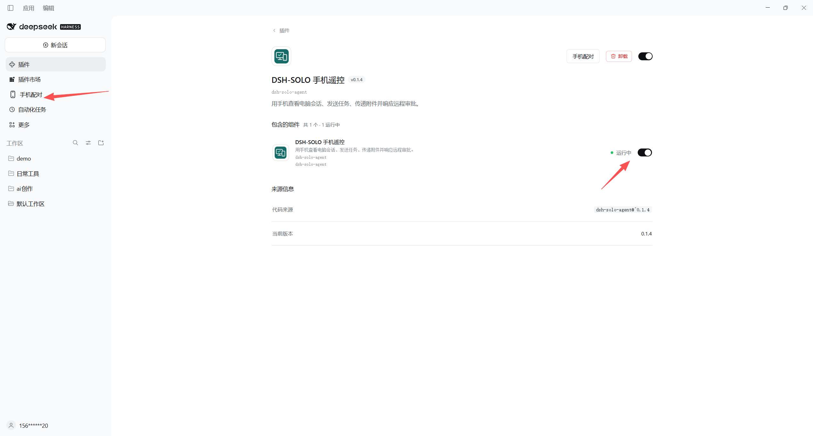
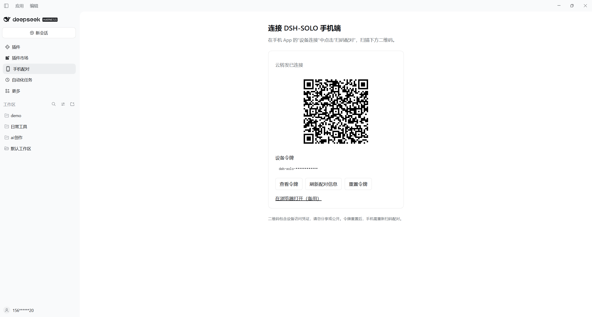
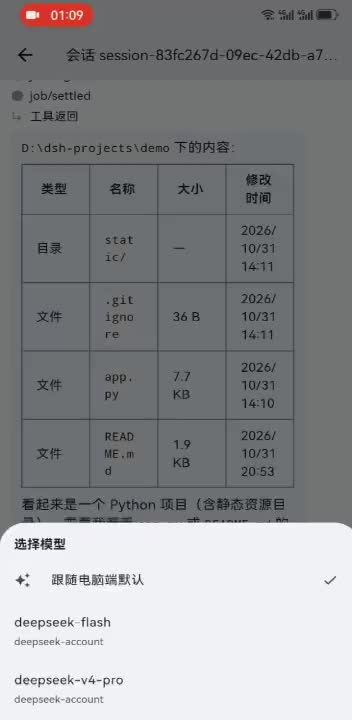
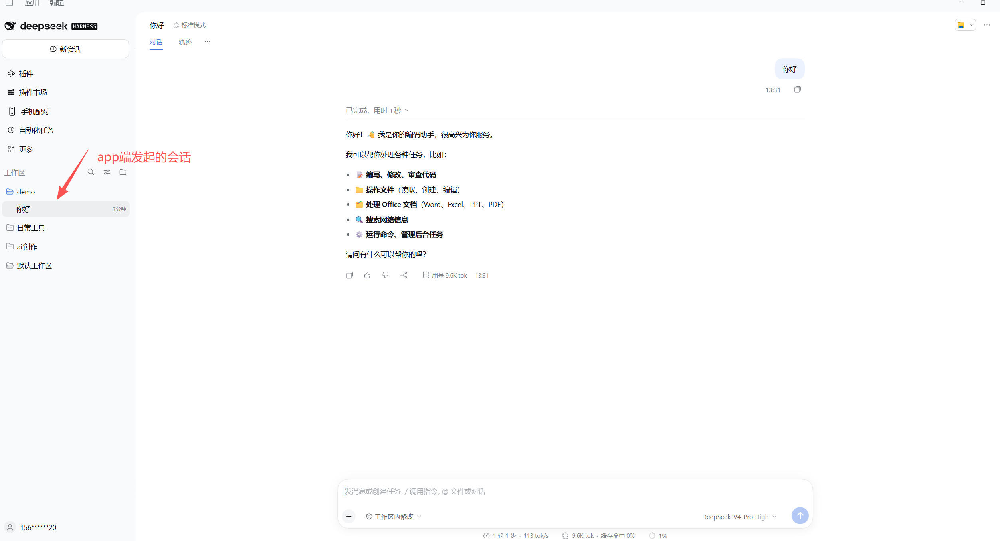

# DSH-SOLO

**中文** | [English](README_EN.md)

通过手机远程使用电脑上的 DeepSeek Harness：查看会话、发送任务、切换模型、传递附件，并审批需要确认的操作。

## 安装与使用

**DSH-SOLO 官方插件已内置官方云转发服务配置。普通用户只需要安装电脑端插件和 Android App，无需部署服务端，也无需填写服务器域名。** 扫码即可将手机与自己的电脑配对。

### 1. 安装电脑端插件（推荐）

在 **DeepSeek Harness 官方桌面版** 中，进入 **插件 → 添加插件**，输入以下包名并点击 **安装**：

```text
dsh-solo-agent
```

安装后点击 **立即启用**。如果左侧没有出现 **手机配对**，通过 **应用 → 退出** 完全退出桌面版，再重新打开；只关闭窗口可能隐藏到托盘。

省略版本号时安装 npm `latest` 标签对应的正式版；需要指定版本时可输入 `dsh-solo-agent@0.1.4`。如果提示找不到插件，请先将安装源切换到 **官方 npm 源**，国内镜像可能尚未同步。已安装的插件需要按宿主提示更新，或卸载后重新安装；通常可保留用户主目录 `.dsh-solo` 中的配对数据。

<details>
<summary>查看插件安装图解（点击展开）</summary>

**① 添加插件，输入 `dsh-solo-agent`**



**② 安装成功后，点击「立即启用」**



**③ 确认插件开关已打开**



**④ 组件显示「运行中」，打开左侧「手机配对」**



</details>

### 2. 下载 Android App

- **[下载最新版 Android APK](https://github.com/wudidiandian/dsh-solo/releases/latest/download/dsh-solo.apk)**
- [查看全部 Releases、版本说明与插件安装包](https://github.com/wudidiandian/dsh-solo/releases)

下载 `dsh-solo.apk` 后在 Android 手机上安装；插件与 App 的版本兼容性以发布说明为准。安装包发布在本项目仓库的 Releases，可直接下载。

### 3. 扫码配对

1. 在 DeepSeek Harness 官方桌面版左侧点击 **手机配对**；插件详情页也有此入口。
2. 在手机 App 中点击 **扫码配对**，扫描页面内的二维码，确认后连接。地址与令牌自动填入。
3. 不方便扫码时，在电脑配对页点击 **查看令牌**，再在 App 中手动填入；官方 App 已预置官方云转发地址。

使用时电脑上的 DeepSeek Harness 和插件需要保持运行，电脑与手机均需联网。二维码包含设备配对凭证，请勿公开分享。Android 为当前交付目标；其他平台需要自行适配和验证。

<details>
<summary>查看电脑端手机配对页面（点击展开）</summary>



图中的二维码仅用于演示。请扫描自己电脑插件中的二维码；令牌重置后，旧二维码失效。

</details>

### 4. 使用演示

[▶ 观看 App 完整操作视频（约 2 分 18 秒）](docs/videos/app-usage.mp4)

点击下方预览图打开视频，演示手机连接、选择电脑项目、发送任务、调用工具列出文件、切换模型，以及重命名和删除会话。

<a href="docs/videos/app-usage.mp4"></a>

**手机创建的会话会同步到电脑端所选项目：**



发送第一条任务前，点击 **＋ → 选择项目**，选择电脑端已添加的项目，新会话会创建在该项目下；已有会话保持原位置。项目列表只获取名称和标识，不扫描项目文件。

主页右上角齿轮提供 **设备连接、使用帮助、隐私与权限、关于 DSH-SOLO**；可查看版本、开源许可和项目链接，或复制不含令牌及聊天内容的连接诊断。

### 其他方式：使用插件安装包

需要离线安装或固定归档时，从 [Releases](https://github.com/wudidiandian/dsh-solo/releases) 下载 `dsh-solo-agent-<版本号>.tgz`。

1. 将 `.tgz` 解压到准备长期保留的目录。有些工具需先解出 `.tar`，再解出文件夹。
2. 找到包含 `package.json` 的 **`package` 文件夹**，例如 `D:/DSH-SOLO/plugin/package`。
3. 在 DeepSeek Harness 官方桌面版 **插件 → 添加插件** 中输入该文件夹的绝对路径，安装并启用。

不要填写单个 `.js` 文件或未解压的 `.tgz`。本地安装会链接到该文件夹，安装后请保留原位置。已有同名插件时先卸载，再安装并按提示重启。

第三方 `dsh-market` 插件市场还需单独收录；发布 npm 或公开 GitHub 不会自动完成市场收录。

## 功能

- 查看会话和实时回复，重连后同步事件。
- 创建任务、选择模型、重命名和删除会话。
- 在手机上允许或拒绝远程审批。
- 上传图片与文件、选择电脑端项目创建会话、发送文档链接。
- 查看 Markdown 回复与代码差异。

## 当前安全与隐私

当前版本**尚未实现手机 App 与电脑插件之间的端到端加密**。使用 WSS 时，客户端到中转入口的传输受到 TLS 保护；中转服务仍能读取转发的消息、任务和附件内容，并在内存中缓存快照及部分事件以支持重连。自建使用普通 WS 时不具备该传输加密。

设备通过随机生成的配对令牌匹配；令牌属于访问凭证，请勿分享二维码或令牌。监控页面仅展示连接与资源统计，不展示会话正文，但这不代表服务器无法读取正文。端到端加密已列为下方最高优先级的计划功能，当前版本不作此承诺。

## 自建与源码构建

源码构建默认连接本机，不包含官方服务器地址。手机自建使用时，请通过电脑端配对二维码获取手机可访问的地址。

环境：Node.js 22、Go 1.22 或更高版本；App 使用 Flutter 3.47.7 / Dart 3.13.5，Android 使用 JDK 17。构建工具版本以工程文件为准。

```sh
npm ci
npm run configure
npm run build
npm run bundle --workspace=dsh-solo-agent
npm test
npm run test:go
```

- [统一配置与发布说明](docs/RELEASING.md)：三端配置、签名、GitHub 自动构建。
- [桌面版插件安装与市场分发](docs/PLUGIN_INSTALLATION.md)：标准安装包、本地验证和第三方市场收录。
- [自建部署](deploy/SELF_HOST.md)：Docker、局域网和隧道接入。
- [服务端监控与部署接管](deploy/MONITORING.md)：维护者登录、连接统计、资源趋势和升级验收。
- [协议定义](packages/protocol/src/index.ts)：开发与集成参考。
- [贡献指南](CONTRIBUTING.md)。

本机运行中转服务：`npm run relay`。插件的 `relayUrl` 可以覆盖构建默认值；手机扫码获取地址和令牌，两端使用相同令牌配对。

## 功能路线图

以下是计划中的功能方向，尚未发布；优先级会根据使用反馈和开发进展调整，具体可用功能以 Release 说明为准。

- [ ] **App ↔ 电脑插件端到端加密（最高优先级，先于 iOS）**：通过扫码验证设备身份，建立独立于中转配对令牌的端侧密钥；加密会话正文、任务、审批与附件，使中转仅转发和缓存密文。同步完善密钥安全保存、消息完整性与防重放、重连及多设备管理、协议版本兼容，避免静默降级到明文。连接 IP、时间和流量大小等元数据仍可能对中转可见；电脑端及其调用的模型服务仍需处理任务内容。
- [ ] **iOS App**：适配 iPhone，打通构建、签名与 TestFlight 测试分发。
- [ ] **鸿蒙端 App**：完成鸿蒙平台适配、HAP 构建与真机验证。
- [ ] **系统通知与离线推送**：在任务完成或需要审批时，通过手机系统通知及时提醒。
- [ ] **语音输入任务**：将语音转为任务文本，方便在手机上发送指令。
- [ ] **多工作站管理**：在手机上切换和管理多台电脑的会话与任务。

欢迎通过 [Issues](https://github.com/wudidiandian/dsh-solo/issues) 反馈需求和使用场景。

## 项目结构

| 目录 | 内容 |
| --- | --- |
| `packages/agent` | 电脑端 Cordis 插件 |
| `packages/protocol` | 通信协议 |
| `app` | Flutter 移动端 |
| `server` | Go 中转服务 |
| `deploy` | 自建部署配置 |

通信方式：手机 App ↔ WebSocket 中转服务 ↔ 电脑端插件。公网部署请使用 WSS。

## 许可证

[MIT](LICENSE)
