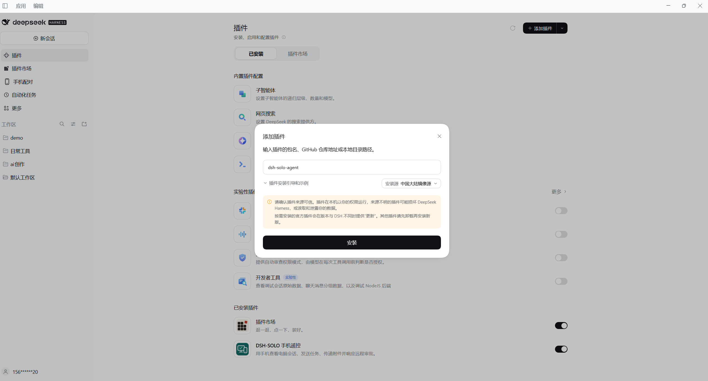
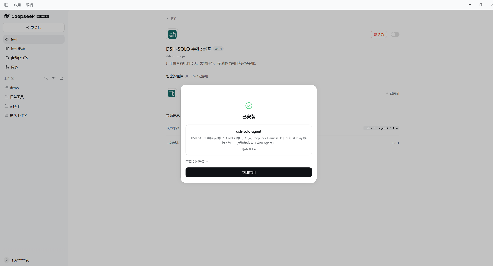
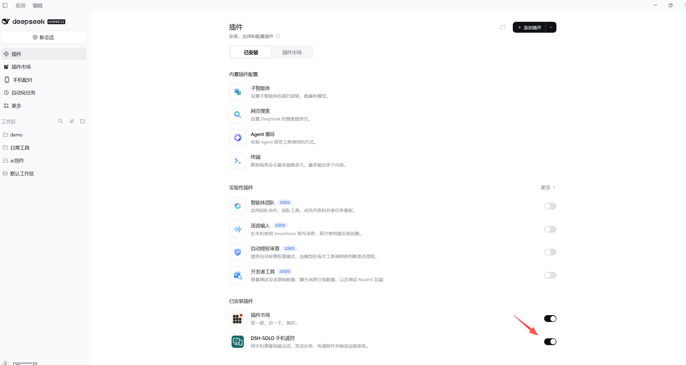
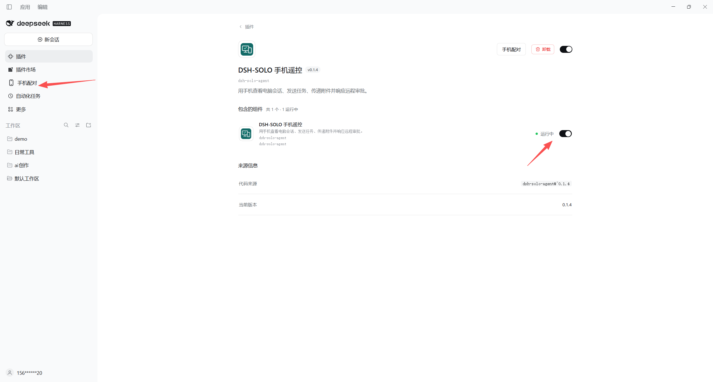
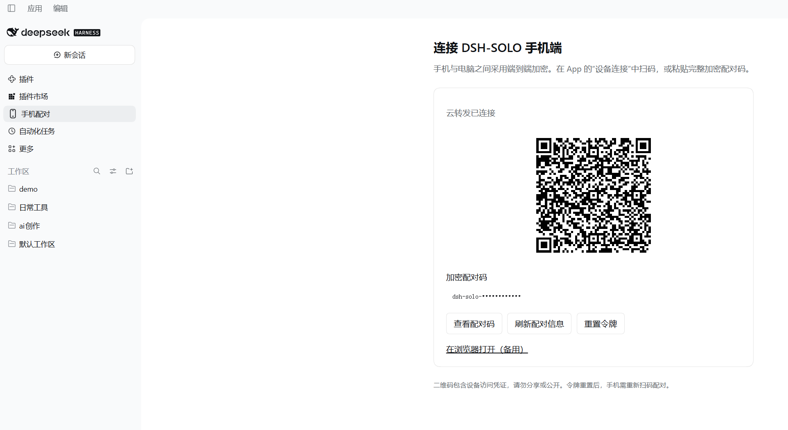
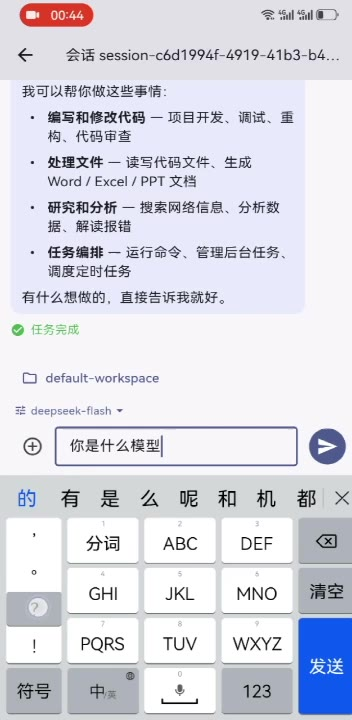
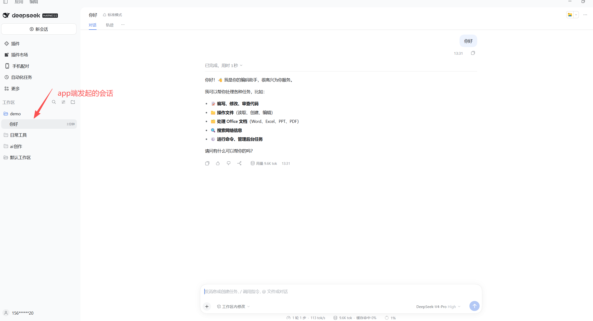

# DSH-SOLO

[](https://www.npmjs.com/package/dsh-solo-agent) [](https://github.com/wudidiandian/dsh-solo/releases) [](LICENSE)

> **Version 0.1.8 is now stable**, fixing the phone model picker missing custom-provider models (catalogs now aggregate across all providers) and showing each session's actual model in the session page; includes the 0.1.7 feature set: device management with per-device revocation, multiple workstations, background notifications, stopping desktop tasks, title sync and auto-refreshing pairing QR. [Release packages](https://github.com/wudidiandian/dsh-solo/releases/tag/v0.1.8) · [Download Android APK](https://github.com/wudidiandian/dsh-solo/releases/latest/download/dsh-solo.apk). Update both the desktop plugin and mobile app.

> **Upgrading (0.1.7 / 0.1.8)**: device management, multiple workstations, background notifications and stopping tasks from the phone require **both the desktop plugin and the app at 0.1.7 or newer**; updating only one side keeps basic features working but leaves the new ones unavailable. Pairing data is retained and re-scanning is usually unnecessary; a phone revoked on the desktop pairing page must re-scan the QR to pair again. The relay protocol is unchanged in this release, so self-hosted servers need no redeployment.

| Component | Minimum version with E2EE | Must update for 0.1.8 |
| --- | --- | --- |
| Desktop plugin `dsh-solo-agent` | 0.1.5 | Yes (new features need the plugin) |
| Mobile app | 0.1.5 | Yes (new features need the app) |
| Relay (including self-hosted) | 0.1.5 | No (no protocol changes since 0.1.5) |

Clients 0.1.4 and older are incompatible with the E2EE trio; crossing 0.1.5 requires updating all three and re-pairing.

[中文](README.md) | **English**

Use DeepSeek Harness on your computer from an Android phone: follow sessions, send tasks, select models, transfer attachments and respond to approvals.

**Contents**: [Install](#install) · [Workstations](#5-manage-multiple-computers-workstations) · [Device management](#6-device-management-and-per-device-revocation) · [Notifications & stop](#7-background-notifications-and-stopping-tasks) · [Features](#features) · [FAQ](#faq) · [Security](#current-security-and-privacy) · [Self-host](#build-and-self-host) · [Roadmap](#roadmap)

> **Phone-to-plugin communication supports end-to-end encryption.** Upgrading from `0.1.4` requires matching relay, plugin and app versions, followed by pairing with a new QR code. Self-hosters should read the [upgrade and rollback guide](deploy/E2EE_UPGRADE.md).

## Install

**The official DSH-SOLO plugin comes preconfigured for the official cloud relay service. Install the plugin and Android app, then scan to pair; no server deployment or server domain entry is required.**

### 1. Install the desktop plugin (recommended)

In the **official DeepSeek Harness desktop app**, open **Plugins → Add plugin**, enter the package name below and select **Install**:

```text
dsh-solo-agent
```

Select **Enable now**. If **Phone pairing** does not appear in the sidebar, fully quit the desktop app through its application menu and reopen it; closing the window may only hide it to the tray.

Without a version suffix, installation uses npm's `latest` stable tag. To pin a version, enter `dsh-solo-agent@0.1.8`. If the package cannot be found, switch to the **official npm registry** while mirrors catch up. Existing installations need an update or reinstall as prompted by the host; pairing data in your home directory's `.dsh-solo` can normally be retained.

<details>
<summary>Desktop plugin installation screenshots</summary>

**1. Add the plugin using `dsh-solo-agent`.**



**2. Select Enable now after installation.**



**3. Confirm the plugin is enabled.**



**4. Confirm the component is running and open Phone pairing.**



</details>

### 2. Download the Android app

- **[Download the latest Android APK](https://github.com/wudidiandian/dsh-solo/releases/latest/download/dsh-solo.apk)**
- [All releases, version notes and plugin packages](https://github.com/wudidiandian/dsh-solo/releases)

Install `dsh-solo.apk` on your Android phone. Check release notes for compatible versions. Packages are available directly from this project repository’s Releases.

### 3. Pair your phone

1. Select **Phone pairing** in the desktop sidebar or plugin detail page.
2. Tap **Scan to pair** in the phone app, scan the embedded QR code and connect. The address and token are filled automatically.
3. For manual pairing, reveal the complete encrypted pairing code on the desktop and paste it into the app. The official app already contains the official relay address.

Keep DeepSeek Harness and the plugin running, with both devices online. Do not share pairing credentials. Android is the current distribution target; other platforms require additional validation.

<details>
<summary>Desktop phone-pairing screenshot</summary>



The QR code in this screenshot is for demonstration. Scan the code on your own computer; resetting its device token invalidates the old QR code.

</details>

### 4. Usage demo

[▶ Watch the full app walkthrough (about 2 minutes 18 seconds)](docs/videos/app-usage.mp4)

Click the preview to open the video. It demonstrates connecting the phone, selecting a desktop project, sending tasks, listing files with tools, switching models, and renaming or deleting sessions. The recording uses the Chinese interface.

<a href="docs/videos/app-usage.mp4"></a>

**A session created on the phone appears in the selected desktop project:**



Before sending the first task, select **+ → Select project** and choose a registered desktop project. The new session is created there; existing sessions stay in place. The project list requests names and IDs without scanning project files.

The home screen gear opens **Device connection, Help, Privacy and permissions, and About DSH-SOLO**. View the installed version, open-source licenses and project links, or copy a connection report without tokens or chat content.

### 5. Manage multiple computers (workstations)

- The **computer icon** at the top right of the home page opens the workstation menu: paired computers are listed and one tap switches; sessions, models and directories are isolated per workstation.
- **Add workstation**: pick it in the menu, then scan another computer's pairing QR (or paste its pairing code); saving stores it.
- **Manage workstations**: rename or delete a pairing; a deleted computer must be re-scanned to connect again.
- Re-scanning the **same computer** never adds a duplicate: the existing pairing is updated and switched to.

### 6. Device management and per-device revocation

- The desktop **Phone pairing** panel (or the fallback browser page) lists paired phones with name and last-seen time.
- **Revoke** disconnects that phone immediately and blocks reconnection until it re-scans the current QR; all of its workstation pairings on that computer stop working.
- **Reset token** clears every device and rotates the master key: all phones must re-scan.
- Legacy apps do not register a device identity, so they are not listed and cannot be revoked individually; upgrade to 0.1.7.
- The QR **refreshes automatically** on key rotation (both panel and browser page poll); always scan the code currently shown.

### 7. Background notifications and stopping tasks

- On first desktop connection the app asks whether to enable notifications: **Enable** grants the system permission; **Not now** never nags again, and you can enable later under **Settings → Notification alerts** (a permanently denied permission jumps to system settings).
- While the app is in the background, completed tasks, pending approvals and stopped tasks raise system notifications; tapping opens the session. No push after the process is killed (offline push is on the roadmap).
- While a session is running, the send button turns into a red **Stop**: tapping interrupts the current desktop turn and the session shows "Task stopped".
- Sessions created or renamed on the desktop keep their titles in the app's session list automatically.

### Alternative: install a plugin archive

For offline installation or a specific archive, download `dsh-solo-agent-<version>.tgz` from [Releases](https://github.com/wudidiandian/dsh-solo/releases).

1. Extract it into a folder you intend to keep. Some tools require extracting the intermediate `.tar` as well.
2. Find the **`package` directory containing `package.json`**, such as `D:/DSH-SOLO/plugin/package`.
3. In the **official DeepSeek Harness desktop app → Plugins → Add plugin**, enter that directory's absolute path, install and enable it.

Select the directory rather than a JavaScript file or an unextracted archive. Keep the directory in place after installation. Uninstall an existing plugin with the same name first and restart as prompted.

Discovery in the third-party `dsh-market` requires separate catalog inclusion; npm publication or a public GitHub repository does not automatically list the plugin.

## Features

- View sessions and live replies; events resynchronize after reconnects. Sessions created or renamed on the desktop keep their titles on the phone.
- Create tasks, pick models, rename and delete sessions; stop a running desktop turn from the phone.
- Allow or deny remote approvals and answer model questions on the phone.
- Upload images and files, create sessions under desktop projects, send document links.
- Read Markdown replies and code diffs.
- Multiple workstations: pair one phone with several computers and switch between them; re-scanning the same computer updates the existing pairing.
- Device management: the desktop pairing page lists paired phones and can revoke a single device; a revoked phone must re-scan the QR.
- Background system notifications for completed tasks, pending approvals and stopped tasks; tapping opens the session (while the app process is alive).

## FAQ

**Plugin not found or an old version at install time?** China npm mirrors lag: switch the install source to the official npm registry, or pin `dsh-solo-agent@0.1.8`. The third-party dsh-market refreshes versions daily; only description changes need a catalog PR.

**No "Phone pairing" entry in the desktop sidebar?** Closing the window may hide it to the tray: fully quit via App → Exit and reopen, and confirm the plugin switch is enabled.

**"Encryption authentication failed" when scanning?** You scanned a stale QR: the master key rotates on new-device registration and resets, and the pairing page QR refreshes automatically — scan the code currently shown. Revoked phones must re-scan; after a token reset every phone re-pairs.

**"Connected" but the session list is empty or tools missing?** A relay connection is not a desktop connection: make sure the computer is awake and the desktop app plus plugin are running; the status chip distinguishes relay-connected / desktop-online / auth-failed.

**No background notifications?** Check the system permission: Settings → Notification alerts → enable (a permanent denial jumps to system settings). Android 12 and below allow by default; no push after the process is killed is a current limitation.

**Why is the APK 70+ MB?** The release package bundles native libraries for arm64 / arm32 / x86_64; installation extracts only your device's architecture. arm64-only preview builds are about 26 MB.

**Do I need to re-pair after upgrading?** 0.1.6 → 0.1.8 usually not (pairing data is retained), except revoked phones; 0.1.4 → 0.1.5+ requires updating all three components and re-scanning (E2EE is incompatible with old clients).

## Current security and privacy

```
┌────────────┐  WSS·cipher  ┌─────────────┐  WSS·cipher  ┌──────────────────┐
│ Phone app  │ ──────────▶ │    Relay     │ ──────────▶ │ Desktop plugin   │
│  Flutter   │ ◀────────── │  Go·self-host│ ◀────────── │ (inside DSH)     │
└────────────┘             └─────────────┘             └──────────────────┘
       ▲                                                    ▲
       └────────── E2EE: X25519 + AES-256-GCM ──────────────┘
              Keys live only at the endpoints; the relay sees
              ciphertext and traffic metadata only
```

Version 0.1.5 implements **phone-to-plugin end-to-end encryption**. An independent QR pairing secret authenticates an ephemeral X25519 exchange. Each phone gets a separate session using AES-256-GCM with integrity and ordered-message replay checks. Conversations, tool results, project lists, approvals and attachment contents are encrypted at the endpoints. Since 0.1.7 each registered phone receives a **device-specific key** and the master pairing key rotates: the desktop can revoke a single phone, invalidating both its old device key and any old QR code it holds; the pairing page QR refreshes automatically on rotation.

The relay forwards ciphertext without pairing secrets or decryption keys. Connection IPs, routing tokens, timing and traffic sizes remain visible. Reconnection history is re-encrypted by the desktop; continue using WSS for public deployments. App pairing credentials use platform secure storage; local session caches do not yet have application-level encryption at rest.

Legacy QR codes and routing tokens alone cannot pair the new clients. Protect complete QR codes and pairing codes; resetting them requires every phone to pair again. The desktop and its configured model services still process task content. Functional and device testing have been completed; the protocol has not undergone an independent security audit. See [design and testing notes](docs/E2EE.md).

## Build and self-host

Requirements: Node.js 22, Go 1.22+, Flutter 3.47.7 / Dart 3.13.5 and JDK 17 for Android. Public source builds default to localhost and contain no official server address.

```sh
npm ci
npm run configure
npm run build
npm run bundle --workspace=dsh-solo-agent
npm test
npm run test:go
```

- [Configuration and releases](docs/RELEASING.md)
- [Desktop installation and marketplace distribution](docs/PLUGIN_INSTALLATION.md)
- [Self-hosting](deploy/SELF_HOST.md)
- [Relay monitoring and deployment handoff](deploy/MONITORING.md)
- [Protocol](packages/protocol/src/index.ts)
- [Contributing](CONTRIBUTING.md)

Run the local relay with `npm run relay`. Override the plugin's `relayUrl` for your deployment and scan its QR code on the phone. Both clients pair using the same device token. Use WSS for public deployments.

## Roadmap

Completed and planned capabilities are listed below. Priorities may change based on feedback and development progress; see release notes for available functionality.

- [x] **End-to-end encryption**: encrypted conversations, tools, projects, approvals and attachments between the phone and plugin, secure credential storage and replay protection.
- [x] **Encryption key management**: device-specific keys, paired-device list with per-device revocation, key rotation and automatic QR refresh.
- [x] **Multiple workstations**: pair one phone with several computers and switch between them; re-scanning the same computer updates the existing pairing.
- [x] **System notifications**: background alerts for completed tasks, pending approvals and stopped tasks, opening the session on tap.
- [ ] **Offline push**: notifications after the app process is killed; requires FCM or vendor push channels, not implemented yet.
- [x] **Stop tasks from the phone**: interrupt the running desktop turn from a session.
- [ ] **iOS app**: iPhone support, build and signing setup, and TestFlight distribution.
- [ ] **HarmonyOS app**: platform adaptation, HAP builds and device testing.
- [ ] **Voice input**: turn speech into task text for sending instructions from a phone.

Share feature requests and use cases through [Issues](https://github.com/wudidiandian/dsh-solo/issues).

## Repository

`packages/agent`: desktop plugin; `packages/protocol`: protocol; `app`: Flutter client; `server`: Go relay; `deploy`: deployment templates.

## License

[MIT](LICENSE)
