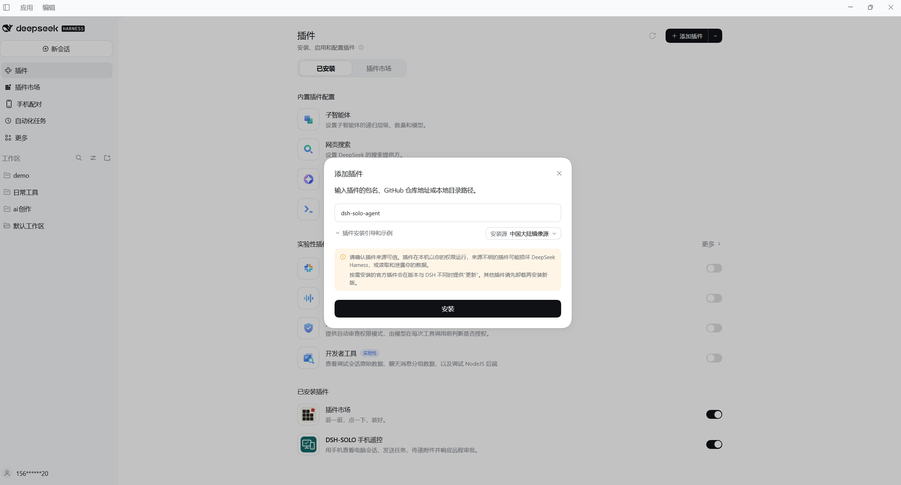
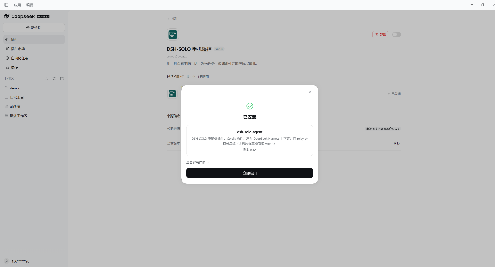
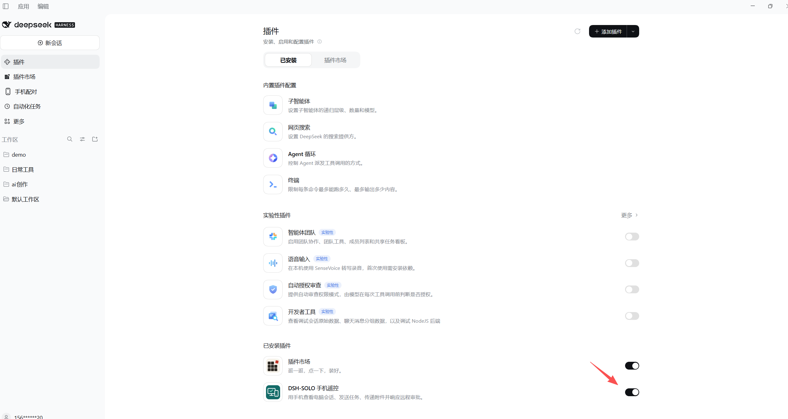
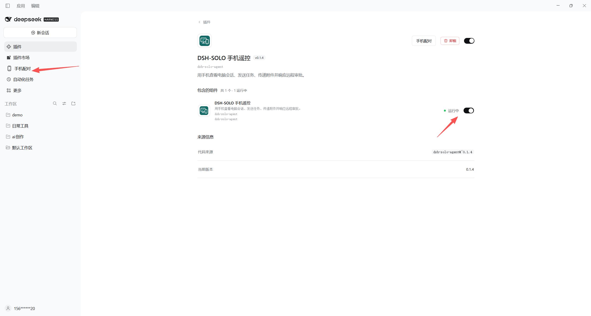
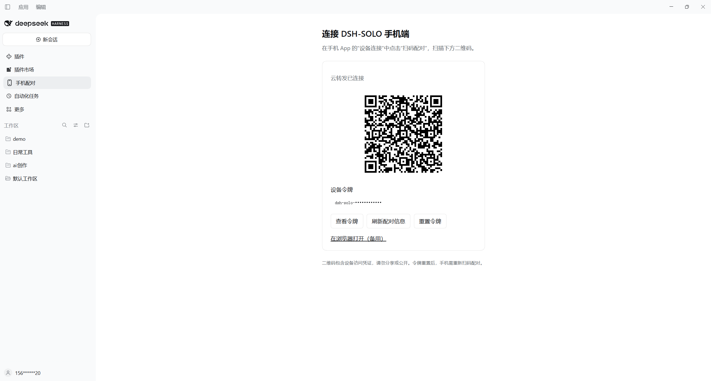
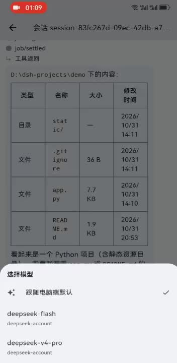
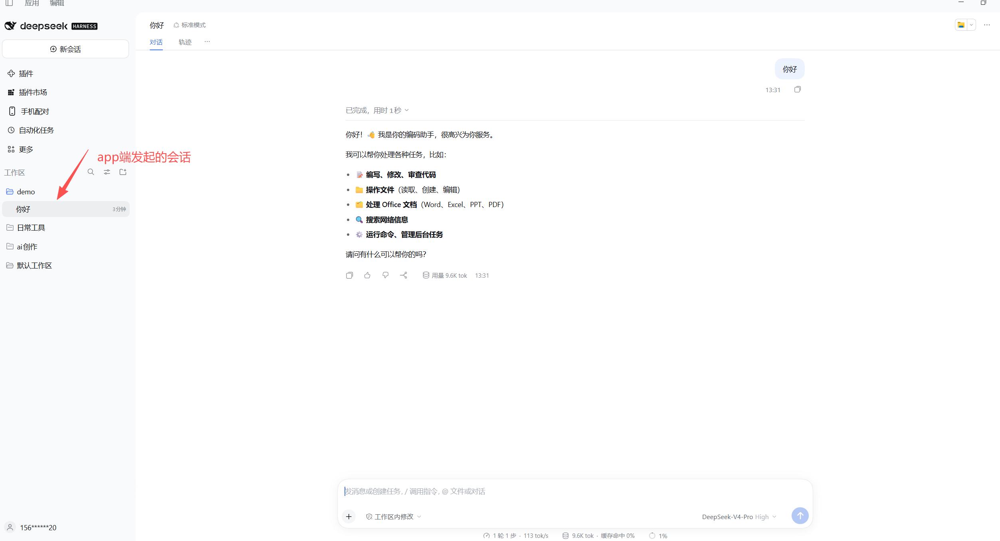

# DSH-SOLO

> Release candidate **0.1.6-rc.1** includes history synchronization, scrolling performance, and mobile approval/question fixes. [Testing notes](docs/releases/v0.1.6-rc.1.md) · [Candidate APK](https://github.com/wudidiandian/dsh-solo/releases/download/v0.1.6-rc.1/dsh-solo.apk). Upgrade both the plugin and App; default installation still uses the stable release.

[中文](README.md) | **English**

Use DeepSeek Harness on your computer from an Android phone: follow sessions, send tasks, select models, transfer attachments and respond to approvals.

> **0.1.5 implements phone-to-plugin end-to-end encryption.** Upgrading from `0.1.4` requires matching relay, plugin and app versions, followed by pairing with a new QR code. Self-hosters should read the [upgrade and rollback guide](deploy/E2EE_UPGRADE.md).

## Install

**The official DSH-SOLO plugin comes preconfigured for the official cloud relay service. Install the plugin and Android app, then scan to pair; no server deployment or server domain entry is required.**

### 1. Install the desktop plugin (recommended)

In the **official DeepSeek Harness desktop app**, open **Plugins → Add plugin**, enter the package name below and select **Install**:

```text
dsh-solo-agent
```

Select **Enable now**. If **Phone pairing** does not appear in the sidebar, fully quit the desktop app through its application menu and reopen it; closing the window may only hide it to the tray.

Without a version suffix, installation uses npm's `latest` stable tag. To pin a version, enter `dsh-solo-agent@0.1.5`. If the package cannot be found, switch to the **official npm registry** while mirrors catch up. Existing installations need an update or reinstall as prompted by the host; pairing data in your home directory's `.dsh-solo` can normally be retained.

<details>
<summary>Desktop plugin installation screenshots</summary>

**1. Add the plugin using `dsh-solo-agent`.**



**2. Select Enable now after installation.**



**3. Confirm the plugin is enabled.**



**4. Confirm the component is running and open Phone pairing.**



</details>

### 2. Download the Android app

- **[Download the latest Android APK](https://github.com/wudidiandian/dsh-solo/releases/latest/download/dsh-solo.apk)**
- [All releases, version notes and plugin packages](https://github.com/wudidiandian/dsh-solo/releases)

Install `dsh-solo.apk` on your Android phone. Check release notes for compatible versions. Packages are available directly from this project repository’s Releases.

### 3. Pair your phone

1. Select **Phone pairing** in the desktop sidebar or plugin detail page.
2. Tap **Scan to pair** in the phone app, scan the embedded QR code and connect. The address and token are filled automatically.
3. For manual pairing, reveal the complete encrypted pairing code on the desktop and paste it into the app. The official app already contains the official relay address.

Keep DeepSeek Harness and the plugin running, with both devices online. Do not share pairing credentials. Android is the current distribution target; other platforms require additional validation.

<details>
<summary>Desktop phone-pairing screenshot</summary>



The QR code in this screenshot is for demonstration. Scan the code on your own computer; resetting its device token invalidates the old QR code.

</details>

### 4. Usage demo

[▶ Watch the full app walkthrough (about 2 minutes 18 seconds)](docs/videos/app-usage.mp4)

Click the preview to open the video. It demonstrates connecting the phone, selecting a desktop project, sending tasks, listing files with tools, switching models, and renaming or deleting sessions. The recording uses the Chinese interface.

<a href="docs/videos/app-usage.mp4"></a>

**A session created on the phone appears in the selected desktop project:**



Before sending the first task, select **+ → Select project** and choose a registered desktop project. The new session is created there; existing sessions stay in place. The project list requests names and IDs without scanning project files.

The home screen gear opens **Device connection, Help, Privacy and permissions, and About DSH-SOLO**. View the installed version, open-source licenses and project links, or copy a connection report without tokens or chat content.

### Alternative: install a plugin archive

For offline installation or a specific archive, download `dsh-solo-agent-<version>.tgz` from [Releases](https://github.com/wudidiandian/dsh-solo/releases).

1. Extract it into a folder you intend to keep. Some tools require extracting the intermediate `.tar` as well.
2. Find the **`package` directory containing `package.json`**, such as `D:/DSH-SOLO/plugin/package`.
3. In the **official DeepSeek Harness desktop app → Plugins → Add plugin**, enter that directory's absolute path, install and enable it.

Select the directory rather than a JavaScript file or an unextracted archive. Keep the directory in place after installation. Uninstall an existing plugin with the same name first and restart as prompted.

Discovery in the third-party `dsh-market` requires separate catalog inclusion; npm publication or a public GitHub repository does not automatically list the plugin.

## Current security and privacy

Version 0.1.5 implements **phone-to-plugin end-to-end encryption**. An independent QR pairing secret authenticates an ephemeral X25519 exchange. Each phone gets a separate session using AES-256-GCM with integrity and ordered-message replay checks. Conversations, tool results, project lists, approvals and attachment contents are encrypted at the endpoints.

The relay forwards ciphertext without pairing secrets or decryption keys. Connection IPs, routing tokens, timing and traffic sizes remain visible. Reconnection history is re-encrypted by the desktop; continue using WSS for public deployments. App pairing credentials use platform secure storage; local session caches do not yet have application-level encryption at rest.

Legacy QR codes and routing tokens alone cannot pair the new clients. Protect complete QR codes and pairing codes; resetting them requires every phone to pair again. The desktop and its configured model services still process task content. Functional and device testing have been completed; the protocol has not undergone an independent security audit. See [design and testing notes](docs/E2EE.md).

## Build and self-host

Requirements: Node.js 22, Go 1.22+, Flutter 3.47.7 / Dart 3.13.5 and JDK 17 for Android. Public source builds default to localhost and contain no official server address.

```sh
npm ci
npm run configure
npm run build
npm run bundle --workspace=dsh-solo-agent
npm test
npm run test:go
```

- [Configuration and releases](docs/RELEASING.md)
- [Desktop installation and marketplace distribution](docs/PLUGIN_INSTALLATION.md)
- [Self-hosting](deploy/SELF_HOST.md)
- [Relay monitoring and deployment handoff](deploy/MONITORING.md)
- [Protocol](packages/protocol/src/index.ts)
- [Contributing](CONTRIBUTING.md)

Run the local relay with `npm run relay`. Override the plugin's `relayUrl` for your deployment and scan its QR code on the phone. Both clients pair using the same device token. Use WSS for public deployments.

## Roadmap

Completed and planned capabilities are listed below. Priorities may change based on feedback and development progress; see release notes for available functionality.

- [x] **End-to-end encryption**: encrypted conversations, tools, projects, approvals and attachments between the phone and plugin, secure credential storage and replay protection.
- [ ] **Encryption key management**: per-device revocation, device management and key lifecycle improvements.
- [ ] **iOS app**: iPhone support, build and signing setup, and TestFlight distribution.
- [ ] **HarmonyOS app**: platform adaptation, HAP builds and device testing.
- [ ] **System notifications and offline push**: notify users when tasks finish or need approval.
- [ ] **Voice input**: turn speech into task text for sending instructions from a phone.
- [ ] **Multiple workstations**: switch between and manage sessions and tasks on multiple computers.

Share feature requests and use cases through [Issues](https://github.com/wudidiandian/dsh-solo/issues).

## Repository

`packages/agent`: desktop plugin; `packages/protocol`: protocol; `app`: Flutter client; `server`: Go relay; `deploy`: deployment templates.

## License

[MIT](LICENSE)
